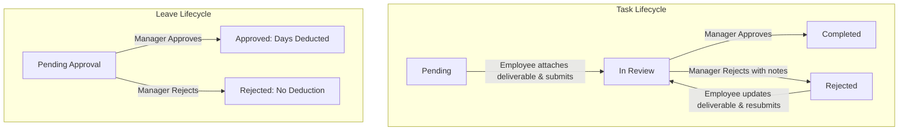

# Employee Management System (EMS) — System Documentation

| | |
|---|---|
| **Project type** | School project – exploring Agentic Coding |
| **Document version** | 2.0 (Fully Aligned & Grilling Finalized) |
| **Date** | October 6, 2026 |
| **Coverage** | Employee role & Department Manager role (fully aligned specifications, data models, workflows, and UI interactions) |

## Contents

1. [System Overview](#1-system-overview)
2. [User Roles & Demo Accounts](#2-user-roles--demo-accounts)
3. [Navigation and Layout](#3-navigation-and-layout)
4. [Account Access & Demo Switcher](#4-account-access--demo-switcher)
5. [Employee Modules](#5-employee-modules)
6. [Department Manager Modules](#6-department-manager-modules)
7. [Attendance Rules & Calculation](#7-attendance-rules--calculation)
8. [Unified Status, Priority & Label Reference](#8-unified-status-priority--label-reference)
9. [Task & Leave Lifecycle Workflows](#9-task--leave-lifecycle-workflows)
10. [Resolved Design Decisions & Architecture](#10-resolved-design-decisions--architecture)

---

## 1. System Overview

The Employee Management System (EMS) is a web-based prototype that enables employees and department managers to manage daily work activities, employee records, attendance (DTR), task deliverables, announcements, and leave applications.

### 1.1 Project Background & Architecture

EMS is developed as a comprehensive demonstration of agentic frontend and full-lifecycle interactive workflows.
- **Client Architecture:** Web application with responsive dark-teal themed design.
- **State & Persistence:** LocalStorage-backed reactive data store simulating real backend persistence across sessions and reloads.
- **Data Lifecycle:** Fully interactive CRUD operations across Tasks, Announcements, Leave Requests, and Attendance Logs.

### 1.2 Scope

| In scope | Out of scope |
|---|---|
| **Employee Role:** Login/Activation, Dashboard, Announcements, Tasks (Submission & Reports), DTR (Time In/Out & Dispute Requests), Leave Request, Profile Management | Admin role and enterprise user provisioning backend |
| **Manager Role:** Login/Activation, Rich Dashboard, Announcement Authoring (`+ Post Announcement`), Department Directory & Attendance, Task Assignment & Deliverable Review, Leave Request Approval / Rejection | Live payroll processing engine |
| **Demo Enhancements:** Quick Role Switcher bar on Login screen, mock LocalStorage database with initial seed dataset | Hardware biometric device physical drivers (simulated entrance clock-in fallback) |

---

## 2. User Roles & Demo Accounts

| Role | Primary Capabilities | Demo Seed Account |
|---|---|---|
| **Employee** | View dashboard metrics, browse/bookmark announcements, submit task deliverables, log attendance (Time In/Out backup), apply for leave, manage personal contact info. | **ID:** `EMP-1012` **Email:** `john.doe@company.com` **Default Password:** `TempPass123!` |
| **Department Manager** | View department overview widgets, post announcements, manage department directory, inspect daily attendance logs, assign tasks & evaluate submissions, approve/reject leave requests. | **ID:** `EMP-1001` **Email:** `sarah.connor@company.com` **Default Password:** `ManagerPass123!` |

---

## 3. Navigation and Layout

Every screen after login shares a unified layout: a persistent dark sidebar on the left and the main workspace on the right, styled with a modern dark-teal glassmorphic aesthetic.

### 3.1 Employee Sidebar

| Sidebar Item | Target View | Badge / Details |
|---|---|---|
| **Dashboard** | Employee Dashboard | Default landing page |
| **Announcement** | Announcements View | Unread count badge |
| **Task** | Tasks View | Total pending/active count |
| **DTR** | Daily Time Record | Monthly time logs & dispute form |
| **Leave Request** | Leave Requests View | Leave balances & history |
| **Profile Block** *(bottom)* | Profile Information | Displays user avatar, name, and position |
| **Log out** *(bottom)* | Returns to Login Page | Clears active session |

### 3.2 Manager Sidebar

| Sidebar Item | Target View | Badge / Details |
|---|---|---|
| **Dashboard** | Manager Command Center | Department summary metrics & shortcuts |
| **Announcements** | Department Announcements | View, filter, and `+ Post Announcement` modal |
| **Employees** | Directory & Attendance View | Department directory & today's attendance log |
| **Task** | Department Task Management | Assigned tasks, `+ Create Task`, and submission review |
| **Leave Request** | Department Leave Queue | Pending approval queue & employee leave history |
| **Profile Block** *(bottom)* | Manager Profile View | Reuses profile structure with supervisor badge |
| **Log out** *(bottom)* | Returns to Login Page | Clears active session |

---

## 4. Account Access & Demo Switcher

### 4.1 Quick Demo Switcher Bar
To facilitate evaluation, the Login page features a top banner / quick selection pills:
- **"Log in as Employee (John Doe - EMP-1012)"**
- **"Log in as Manager (Sarah Connor - EMP-1001)"**
Clicking either button auto-fills the credentials and activates the respective role session immediately.

### 4.2 Standard Authentication & Activation Flow
1. **Login Page:** Email and password inputs, masked password toggle, Remember Me, Forgot Password link, and Account Activation link.
2. **Account Activation:** User enters `EMP-####` and company email. Verifying matches sends a temporary default password and redirects to Login.
3. **First-Time Credential Update:** On initial login with default password, users are prompted to set their permanent username and custom password before landing on their Dashboard.

---

## 5. Employee Modules

### 5.1 Dashboard
- **Attendance Overview:** Weekly bar chart (Monday to Sunday) displaying hours worked per day, colored by attendance status (`Present`, `Late`, `Half-day`, `Absent`, `Rest day`).
- **Time Tracker Widget:** Real-time digital clock, shift indicator (`9:00 AM – 6:00 PM`), 15-minute grace period indicator, running session timer, and Time In / Time Out button.
- **Announcements Preview:** Latest 3 department/company announcements with unread indicator dot and category tags.
- **Tasks Preview:** Latest assigned tasks sorted by urgency with due dates, priority pills, and quick submission links.

### 5.2 Announcements
- **Card Grid:** Event date badge, category tag (`General`, `Event`, `Notice`, `Emergency`), author department, title, description preview, attachment previews, and bookmark toggle.
- **Flags:** Explicit badges for `"Important Notice"` and `"Mandatory Attendance"`.
- **Search & Filter:** Keyword search + Category filter dropdown + Tabs (`All`, `Unread`, `Important`, `Bookmarked`).
- **Unread State:** Green indicator dot disappears once an item is viewed or opened.

### 5.3 Tasks
- **Summary Metric Cards:** Total Assigned, Pending, In Review, and Completed counts.
- **Search & Filters:** Search by title/assigner, filter by status (`All`, `Pending`, `In Review`, `Completed`, `Rejected`).
- **Task Detail & 'Your Work' Submission Panel:**
  - View task requirements, priority (`High`, `Medium`, `Low`), assigning manager, and due date.
  - File upload / link attachment area for deliverables.
  - **Submit Button:** Becomes active once deliverable is attached. Transitions status to `In Review`.
  - **Rejected Tasks:** Display manager feedback notes and switch the submit button to `Resubmit`.
- **File a Report Action:** Task report modal with issue selection (*Incorrect deadline*, *Task description unclear*, *Missing info*, *Wrong assignee*, *Other*) to notify manager.

### 5.4 Attendance Record (DTR)
- **Month Selector:** Navigate past and current monthly attendance cycles.
- **Shift & Grace Period Banner:** Displays standard `9:00 AM – 6:00 PM` work schedule.
- **Monthly Summary Cards:** Counts for Present, Late, Half-day, Rest Day, and Absent.
- **Detailed Attendance Table:** Date, Time In, Time Out, Break deduction (1 hour standard), Net Hours Worked, and Status tag.
- **Request Adjustment Modal:** Allows employees to submit an attendance dispute explanation for missing logs or corrections.

### 5.5 Leave Request
- **4 Standardized Balance Cards (10 Days Base Each):**
  1. **Sick Leave (SL)**
  2. **Vacation Leave (VL)**
  3. **Casual / Emergency Leave (CL)**
  4. **Maternity / Paternity Leave (ML/PL)**
- **Apply Leave Modal:** Leave Type dropdown, From Date, To Date (with validation `To Date >= From Date`), Reason text, and optional document attachment (JPEG, PNG, PDF up to 5MB).
- **Leave History Table:** Type, date range, number of days, reason, submission timestamp, assigned approver name (or `"Pending Approval"`), and status badge (`Pending`, `Approved`, `Rejected`).

### 5.6 Profile Information
- **Read-Only Employment Info:** Employee ID, Department, Position, Employment Type, Date Hired, Work Schedule (`9:00 AM – 6:00 PM`).
- **Editable Personal & Contact Details:** Full Name, Gender, Phone Number, Company Email, Home Address, Emergency Contact.
- **Security:** Masked password with "Change Password" modal dialog.

---

## 6. Department Manager Modules

### 6.1 Manager Dashboard (Command Center)
- **Department Attendance Summary Widget:** Donut/bar breakdown of today's attendance across department staff (Present, Late, On Leave, Absent).
- **Pending Approvals Queue:** Quick-action list of pending Leave Requests and pending Task Deliverables awaiting review.
- **Department Task Status Overview:** Metric cards for Active Tasks, Tasks Under Review, Completed Tasks, and Overdue Tasks.
- **Quick Action Bar:** Direct buttons to `+ Post Announcement`, `+ Assign Task`, and `Review Attendance`.

### 6.2 Announcements & Post Authoring
- **Announcement Directory:** Browse all announcements with full filter tabs and bookmarking.
- **`+ Post Announcement` Modal:**
  - **Fields:** Title, Category (`General`, `Event`, `Notice`, `Emergency`), Event Date & Time, Audience/Target Department, Flags checkbox (`Important Notice`, `Mandatory Attendance`), Content/Description, and Attachment upload.
  - Submitting immediately broadcasts the announcement to all employee dashboards and list views.

### 6.3 Employees & Attendance
- **Directory Tab:** Searchable list of department employees with Employee ID, Name, Job Position, Status (`Active`, `On Leave`), and quick link to view Employee Profile.
- **Attendance Tab:** Real-time departmental daily attendance sheet with Date filter, Employee ID, Employee Name, Time In, Time Out, Hours Worked, and Unified Status (`Present`, `Late`, `Half-day`, `Absent`, `Rest day`).

### 6.4 Task Management (Assign & Review)
- **Assigned Tasks List:** Filterable by status (`All`, `Pending`, `In Review`, `Completed`, `Rejected`).
- **`+ Create Task` Modal:** Title, Assignee Employee (dropdown of department members), Priority (`High`, `Medium`, `Low`), Due Date, Description, and Reference Attachments.
- **Review Submission Modal:**
  - Displays submitted deliverables and employee comments.
  - Actions:
    - **Approve (Mark Completed):** Confirms completion and updates task status to `Completed`.
    - **Reject (Request Revision):** Allows manager to input feedback notes and returns task to employee as `Rejected`.

### 6.5 Leave Request Management
- **Department Queue:** List of all employee leave applications.
- **Direct Decision Actions:** One-click `Approve` or `Reject` buttons with confirmation dialog.
- **Employee Leave History Drawer:** Selecting any request opens the employee's historical leave requests and remaining balances across all 4 leave types.
- **Deduction Rule:** Approving a request automatically deducts the requested days from the employee's balance and stamps the manager's name as Approver.

---

## 7. Attendance Rules & Calculation

### 7.1 Schedule & Grace Period
- **Standard Work Schedule:** `9:00 AM – 6:00 PM` (Monday to Friday, 9 hours total including 1-hour lunch break = 8 working hours).
- **Grace Period:** 15 minutes (`9:00 AM – 9:15 AM`).

### 7.2 Unified Status Rules

| Status | Rule & Condition | Chart Color |
|---|---|---|
| **Present** | Time In on or before `9:15 AM` and worked full shift (>= 8 net hours). | Green (`#10B981`) |
| **Late** | Time In after `9:15 AM` and worked remaining shift. | Amber (`#F59E0B`) |
| **Half-day** | Worked between `4.0` and `7.9` net hours (e.g. late arrival after 1:00 PM or early departure before 5:00 PM). | Blue (`#3B82F6`) |
| **Absent** | No time-in record on a scheduled working day without approved leave. | Red (`#EF4444`) |
| **Rest day** | Non-working scheduled day (Saturday, Sunday, or declared company holiday). | Slate Grey (`#64748B`) |

$$\text{Net Hours Worked} = (\text{Time Out} - \text{Time In}) - \text{Break Duration (1 hr)}$$

---

## 8. Unified Status, Priority & Label Reference

### Reference Values

| Entity | Allowed Values |
|---|---|
| **Task Statuses** | `Pending`, `In Review`, `Completed`, `Rejected` |
| **Task Priorities** | `High`, `Medium`, `Low` (with `Overdue` flag when `Current Date > Due Date`) |
| **Leave Types** | `Sick Leave`, `Vacation Leave`, `Casual / Emergency Leave`, `Maternity / Paternity Leave` |
| **Leave Statuses** | `Pending`, `Approved`, `Rejected` |
| **Announcement Categories** | `General`, `Event`, `Notice`, `Emergency` |
| **Announcement Flags** | `Important Notice`, `Mandatory Attendance` |
| **Attendance Statuses** | `Present`, `Late`, `Half-day`, `Absent`, `Rest day` |

---

## 9. Task & Leave Lifecycle Workflows

### 9.1 Task Deliverable Flow
1. Manager creates task -> Status set to `Pending`.
2. Employee views task under `My Tasks`, works on it, and uploads the deliverable file/link.
3. Employee clicks `Submit` -> Status transitions to `In Review`. Task is locked from further employee edits.
4. Manager opens `Review Submission`:
   - If acceptable: Manager clicks `Approve` -> Status permanently marked `Completed`.
   - If revisions needed: Manager enters feedback and clicks `Reject` -> Status becomes `Rejected`.
5. Employee sees `Rejected` tag and supervisor notes -> clicks `Resubmit` after revising.

### 9.2 Leave Application Flow
1. Employee fills `Apply Leave` form (Type, Dates, Reason, Optional Attachment) -> Status set to `Pending`.
2. Manager receives notification on Manager Dashboard under `Pending Approvals`.
3. Manager opens request, inspects employee's leave balance and past history.
4. Manager makes decision:
   - **Approve:** Days subtracted from employee's balance; approver recorded as Manager's Name; status set to `Approved`.
   - **Reject:** No balance deducted; status set to `Rejected`.

---

## 10. Resolved Design Decisions & Architecture

All open items from specification review and grilling sessions are formally resolved as follows:

| Decision Area | Finalized Specification |
|---|---|
| **Data Persistence** | Reactive LocalStorage state engine with pre-seeded mockup dataset. Persists CRUD modifications across page reloads. |
| **Demo Experience** | Quick Demo Switcher bar on Login screen allowing 1-click login as Demo Employee (`EMP-1012`) or Demo Manager (`EMP-1001`). |
| **Work Schedule Alignment** | Standardized to `9:00 AM – 6:00 PM` with 15-minute grace period across all screens, charts, and calculations. |
| **Attendance Status Alignment** | Unified 5-status model (`Present`, `Late`, `Half-day`, `Absent`, `Rest day`) shared by both Employee DTR and Manager Attendance. |
| **Leave Categories** | Standardized 4 categories: `Sick Leave`, `Vacation Leave`, `Casual / Emergency Leave`, and `Maternity / Paternity Leave` (10 days balance each). |
| **Leave Balance Deduction** | Days deducted strictly upon Manager `Approved` action. Approver field displays resolving Manager's name. |
| **Manager Announcement Authoring** | Direct `+ Post Announcement` modal on Manager Announcements page supporting categories, flags, dates, and attachments. |
| **Manager Dashboard Layout** | Comprehensive command center with Department Attendance Donut/Bar breakdown, Pending Approvals queue, and Department Task metrics. |
| **Task Status & Naming** | Aligned to `Pending`, `In Review`, `Completed`, and `Rejected`. Task summary counts use consistent terminology. |
| **Task Discrepancy Reporting** | Standardized modal with preset problem categories accessible via task card actions. |
